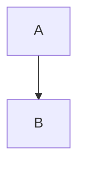

Mermaid diagrams now render with Mermaid 12. Flowchart, state, class, ER and requirement diagrams that do not set a `layout` are laid out with ELK instead of dagre and use the new `neo` look, so existing diagrams re-flow and recolour. The ELK layout engine loads as a separate chunk (about 1.5 MB before compression) only on pages whose diagrams use it. To keep the previous look for one diagram, add a config block at the top of it:

Mermaid 12 targets ES2024 browsers (Safari 17.4+), and its package declares Node.js 22.12 or later.
