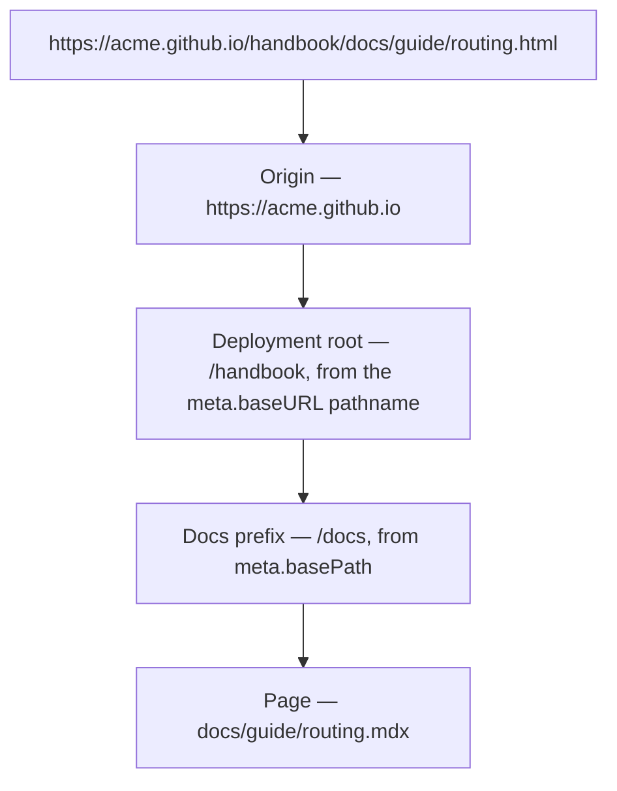

Flame always emits a flat `.html` build, but the URL shape it is served under is configurable. Two independent settings decide that shape, and mixing them up is the usual cause of broken assets after a move:

| Setting | Prefix it controls | Lives in | Example |
| ------- | ------------------ | -------- | ------- |
| `meta.basePath` | The docs prefix **inside** the build output | `docu.json` | `/docs` (default), `/handbook`, `""` |
| `meta.baseURL` | Origin **plus deployment root** — the path the host serves the dist under | `docu.json` | `https://book.acme.dev`, `https://acme.github.io/handbook` |



## Docs prefix

`meta.basePath` is where the docs site sits inside the dist **and** in the URL. It defaults to `/docs`, so leaving it unset keeps the historical layout:

```json:docu.json
{
  "meta": {
    "title": "Acme Docs",
    "baseURL": "https://book.acme.dev",
    "basePath": "/handbook"
  }
}
```

| Value | Docs served at | Pages written to |
| ----- | -------------- | ---------------- |
| `/docs` (default) | `https://host/docs/getting-started.html` | `.docu/dist/docs/getting-started.html` |
| `/handbook` | `https://host/handbook/getting-started.html` | `.docu/dist/handbook/getting-started.html` |
| `""` or `"/"` | `https://host/getting-started.html` | `.docu/dist/getting-started.html` |

The prefix is applied everywhere a docs URL is produced — the dev server and static routing, internal links and asset paths in rendered pages, canonical and Open Graph URLs, the search index, and the nginx config generated by `flame deploy --docker`. It is also part of the build cache key, so changing it rebuilds every page instead of reusing HTML that points at the old prefix.

You do not have to rewrite your content when you change it: links authored as `/docs/guide/routing` are re-based onto the configured prefix, so one `docu.json` works at `/docs`, at `/handbook`, and at the deployment root. See [Formatting](/docs/getting-started/formatting) for the link rules.

## Deployment root

`meta.baseURL` is the **origin plus the deployment root** — the base a browser prepends to every root-absolute path. Its pathname is the *deployment path*: empty when the origin serves the dist at `/`, `/repo` when the host publishes the artifact under a path.

```json:docu.json
{
  "meta": {
    "title": "Acme Docs",
    "baseURL": "https://acme.github.io/handbook"
  }
}
```

Flame prepends it to every root-absolute URL that points into the build: sidebar, navbar and pagination links, the logo, the landing page link, the `404.html` fallback's bundle assets and the search index records. It is also the base canonical and Open Graph URLs are resolved against. Page stylesheets and scripts are linked relatively, so they line up on their own. The dev server always serves from the origin root and leaves the deployment path out.

:::warning{title="Do not repeat the docs prefix"}
`baseURL` stops at the deployment root; `basePath` adds the docs prefix on top. With `basePath: "/docs"` and `baseURL: "https://acme.github.io/handbook"`, canonical URLs become `https://acme.github.io/handbook/docs/…`. Writing the prefix into both produces `/handbook/docs/docs/…`.
:::

## Common setups

| Hosting | `meta.baseURL` | `meta.basePath` | Docs URL |
| ------- | -------------- | --------------- | -------- |
| Default local/production | `https://book.acme.dev` | omit (defaults to `/docs`) | `https://book.acme.dev/docs/…` |
| Custom prefix on your own domain | `https://book.acme.dev` | `/handbook` | `https://book.acme.dev/handbook/…` |
| GitHub Pages project site | `https://acme.github.io/handbook` | omit (defaults to `/docs`) | `https://acme.github.io/handbook/docs/…` |
| GitHub Pages project site, docs at the artifact root | `https://acme.github.io/handbook` | `""` | `https://acme.github.io/handbook/…` |
| GitHub Pages user/org site | `https://acme.github.io` | omit (defaults to `/docs`) | `https://acme.github.io/docs/…` |

For a **project site**, `baseURL` must include the repository segment — that is the path GitHub Pages serves the artifact under. Without it, the search index and the 404 fallback point at the origin root and return 404.

## Root deployment

Setting `"basePath": ""` serves the docs at the deployment root. Two details follow from that:

- **Pages move to the dist root.** `docs/getting-started.mdx` → `.docu/dist/getting-started.html`, and the URL is `/getting-started.html` under the deployment root.
- **The landing page owns `/`.** The docs index (`docs/index.mdx`) is not written — it would collide with the generated landing page — and `index.html` left over from a previous build is removed. Author links as usual: `/docs/guide/routing` collapses to `/guide/routing`.

The docs index is optional in every setup: when `docs/index.mdx` (or `docs/index.md`) is absent, the build simply produces no docs index page — the landing page always owns `/`. The exception is a project that [brings its own pages](#bring-your-own-pages): there is no generated landing page then, so at the root the docs index takes `/`.

:::info{title="Docker at the root"}
With an empty prefix, the two asset trees — hash-named bundles at `/assets/` and content assets copied from `docs/assets/` — land on the same path, and nginx rejects a duplicate `location /assets/` block. The generated `nginx.conf` therefore omits the content-assets cache block (7d) and lets the immutable bundle rules win; the files are still served. The same applies to a prefix containing characters nginx cannot use in a `location` name — the build logs a warning and drops the block.
:::

## Bring your own pages

By default Flame also generates the landing page at `/` (from `home` in `docu.json`). A project that already has its own site — a React app at the repository root, or anything else that serves the same origin — can switch it off and keep everything Flame builds under the docs prefix:

```json:docu.json
{
  "meta": {
    "title": "Acme Docs",
    "baseURL": "https://acme.dev",
    "basePath": "/docs"
  },
  "experimental": {
    "pages": true
  }
}
```

With the flag on, the build owns nothing outside `meta.basePath`:

- **No landing page.** `index.html` is not written at the dist root, and no landing bundle is built. `home` is ignored, and the build logs a warning while the section is still present.
- **The 404 page stays Flame's** and moves to `<basePath>/404.html`, so it never replaces your app's own root 404.
- **Bundles move under the prefix.** Hashed JS and CSS, the asset manifest and the search index are written to `<basePath>/_flame/` instead of the dist-root `assets/`, which Vite and most React toolchains use for their own output.
- **Stale output is cleaned up.** Files a default build left at the dist root are removed, and turning the flag off again removes `_flame/`.

```
.docu/dist/
└── docs/                # meta.basePath — the only directory Flame writes
    ├── _flame/          # hashed bundles, manifest.json, search-index.json
    ├── assets/          # copied from docs/assets
    ├── 404.html
    ├── index.html
    └── getting-started.html
```

With a root basePath (`""` or `"/"`) nothing else can own `/`, so the docs index is written to the dist root and the 404 stays at `/404.html`. Bundles still move to `/_flame/`, so they no longer share `/assets/` with the content assets.

:::warning{title="A root basePath cannot share the origin"}
At the root, the docs own `/`, `index.html`, `404.html` and every page path, so they would overwrite or shadow your app's files. This only suits a docs-only site that wants the docs index as its homepage instead of the generated landing page. The build and `flame dev` print a warning for this combination, and the `docu.json` schema flags it in your editor. To serve the docs next to your own app, set a prefix such as `"/docs"`.
:::

The flag is off by default, so existing projects keep byte-identical output until they opt in.

### Serving the docs next to your app

Because everything sits under the prefix, one route rule for `/docs/*` is all a host needs. Two setups cover most platforms.

**One project, merged output.** A host publishes one output directory; the framework preset only picks default commands. When your app builds to static files, build both and copy the dist into the app's output — the trees do not overlap:

```json:vercel.json
{
  "buildCommand": "vite build && flame build && cp -r .docu/dist/. dist/",
  "outputDirectory": "dist",
  "cleanUrls": true
}
```

**Two deployments, joined by a rewrite.** Deploy the docs as their own site and forward the prefix from your app. This also works when the app renders on the server, as with Next.js:

```json:vercel.json
{
  "rewrites": [
    { "source": "/docs/:path*", "destination": "https://acme-docs.vercel.app/docs/:path*" }
  ]
}
```

The same pattern is a proxy rule (`/docs/*  https://acme-docs.netlify.app/docs/:splat  200`) in Netlify's `_redirects`, or a `location /docs/` block in nginx. Flame has no output-directory option: copying the dist is one explicit line in your own build, and writing into another project's tree would pick up that platform's static-file rules.

A docs-scoped 404 needs the host to know about it. nginx can point `error_page` at `/docs/404.html` inside the docs location. On Netlify, a `/docs/*  /docs/404.html  404` rule on the site that serves the docs files does the same, because existing files take precedence over redirect rules. Hosts that only honor a root `404.html` show your app's 404 for missing docs pages.

### What the commands do

| Command | Behavior under the flag |
| ------- | ----------------------- |
| `flame dev` | `/` redirects to the docs prefix. Your own pages are not served — run your app's dev server alongside. With `"basePath": ""`, `/` is the docs index. |
| `flame preview` | Same redirect at `/`. Unknown paths answer with the docs 404 page. |
| `flame build` | Writes only under the prefix. The flag is part of the cache key, so flipping it rebuilds every page. |
| `flame deploy` | GitHub Pages hosts only the docs, so the generated workflow builds with `FLAME_STANDALONE=1`: the artifact gains a root `index.html` that redirects to the docs and a root copy of the 404 page. A plain `flame build` never writes either. |
| `flame deploy --docker` | The generated nginx config redirects `/` to the docs, sends 404s to `<basePath>/404.html`, and caches `<basePath>/_flame/` as immutable. |

:::info{title="Existing deploy files"}
`flame deploy` keeps an existing `nginx.conf` and `.github/workflows/deploy.yml`. When one of them predates the flag, the command prints a warning: delete the file and rerun `flame deploy` to regenerate it, or add `FLAME_STANDALONE: "1"` to the workflow's build step yourself.
:::

## Canonical form

The prefix is both a URL path and an output directory, so it is canonicalized to lowercase segments with no trailing slash, no dot segments, and nothing that needs percent-encoding. The schema describes the accepted shape:

```json
{
  "pattern": "^(|/|/[a-z0-9._~-]+(/[a-z0-9._~-]+)*)$",
  "maxLength": 128
}
```

Non-canonical values are still honored — Flame normalizes them and logs a warning naming the canonical value, so you can update `docu.json` and keep the editor quiet:

| Written | Resolved | Note |
| ------- | -------- | ---- |
| `/docs` | `/docs` | Canonical — no warning |
| `""`, `/`, `"///"` | `""` | Deployment root — no warning |
| `" "`, `"   "` | — | **Build error**: whitespace only — use `""` or `/` for the root |
| `/Docs` | `/docs` | Non-lowercase letters |
| `/docs me` | `/docs-me` | Whitespace becomes a dash |
| `/docs/two words` | `/docs/two-words` | Whitespace becomes a dash |
| `/docs//guide` | `/docs/guide` | Doubled separator collapsed |
| `/docs/../guide` | `/docs/guide` | Dot segment dropped |
| `/docs/€` | `/docs` | Unservable characters dropped |
| `123`, `null` | — | **Build error**: the value must be a string |

Two values are hard failures: a non-string, which cannot be normalized, and a whitespace-only string, which is almost certainly a typo — reading it as the root would silently move every page. Everything else is reported and normalized at the start of `flame dev` and `flame build`, before any output is written.

## Verify

After a build, the prefix should show up consistently in each of these places:

| Check | Where to look |
| ----- | ------------- |
| Output layout | `.docu/dist/<prefix>/…` (or the dist root when the prefix is empty) |
| Generated links | View source of a built page — internal links carry the prefix and `.html` |
| Canonical URL | `<link rel="canonical">` in a built page |
| Search index | Open the search modal and confirm a result's target URL |
| 404 fallback | `.docu/dist/404.html` — its bundle assets carry the deployment path |
| nginx (Docker) | The generated `nginx.conf` at the project root — the content-assets block matches the prefix |

:::info{title="Dev server"}
`flame dev` serves the docs under the configured prefix, so `/handbook/…` works locally too. The host's deployment path is not simulated in dev — it only exists in built output, where a host actually publishes the dist under a path.
:::
